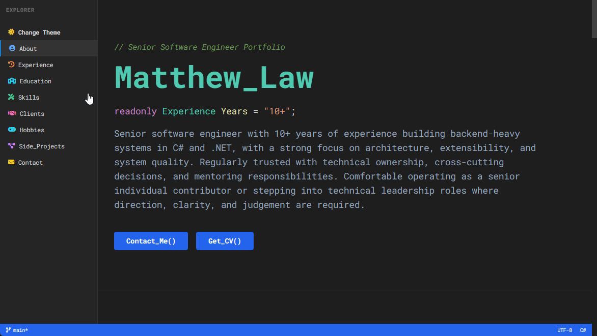

# Matthew Law | Senior Software Engineer

The source behind [my portfolio](https://matthewclaw.github.io/profile/). It's built to look like VS Code, mostly because that's where I spend my day.



- [Jump straight to my downloadable CV](https://matthewclaw.github.io/profile/assets/docs/cv.pdf)

## How it's built

There's no framework and nothing renders in the browser. The pages are plain HTML that a small Node build fills in ahead of time, so the site reads fine with JavaScript turned off. The JS that does ship only handles the theme toggle, the sidebar and the fade-in.

- **`assets/data/data.json`** is the single source for experience, clients, credentials, hobbies, projects and contact details. The homepage, `cv.html`, `generated/resume.md` and the JSON-LD all come from it.
- **`scratchpad/drafts/*.md`** are the Scratchpad posts. Each one is rendered to its own page and its card is synced back into `data.json`. The format is in [the drafts README](scratchpad/drafts/README.md).
- **`util/*.js`** is the build. It compiles Tailwind, renders the drafts and the Scratchpad index, generates the JSON-LD and `resume.md`, then injects everything between the `<!-- NAME:START -->` / `<!-- NAME:END -->` markers in `index.html` and `cv.html`. It also writes `robots.txt` and `sitemap.xml`.

```
npm ci
npm run debug
```

Use `npm run debug` locally. `npm run build` is the production build: it strips the JSON-LD markers out of `index.html`, which breaks the next build if that output gets committed.

## Deploying

Every push to `main` runs a GitHub Actions workflow. It does a production build, removes the tooling and source files, and publishes what's left to GitHub Pages.

`cv.pdf` isn't built. I export it from `cv.html` in Chrome by hand.

## Let's Connect

- **[Email](mailto:Matthew.mcsd@gmail.com)**
- **[LinkedIn](https://www.linkedin.com/in/matthew-c-law/)**
- **[GitHub](https://github.com/matthewclaw)**
